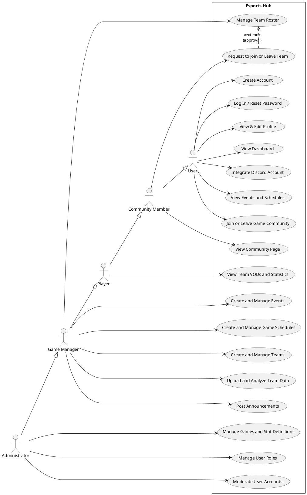

# Esports Hub — Requirements Baseline (Phase 0)

Status: **Approved and implemented** (Phases 1–6). See `traceability.md` for requirement coverage and `test-report.md` for results.

### Changes made during implementation
- **Calendar UI** is a server-rendered month grid + agenda instead of FullCalendar (faster for NFREQ8, no client bundle, accessible).
- **Rate limiting** moved from memory to Postgres (multi-instance safe); per-IP limits raised for shared campus networks.
- **Derived stats** are computed on read, not stored, so formula edits apply to past matches.
- **`games`** is a built-in formula variable (number of matches) for rates like win %.
- **iCal feed URL** is shown once at creation; only its hash is stored.
- **Seasons** remain a free-text label on teams.
Source documents: userContext, useCases, useCaseSpecification, useCaseDiagram, requirements (CSV).

---

## 1. Glossary (resolves C3)

| Term | Definition |
|---|---|
| **User** | Anyone with a verified account. |
| **Game** | A supported title (e.g., a specific esports game). Each Game has exactly one Game Community. |
| **Game Community** | Open membership group for a Game. Any User may join or leave. Members are **Community Members** of that game. |
| **Team** | A managed squad within a Game. Status: `shell` (no players), `active`, `archived`. |
| **Roster** | The list of Players on a Team. "Joining a roster" = joining a Team. |
| **Player** | A Community Member who is on at least one Team's roster for that game. |
| **Game Manager (GM)** | A user assigned by an Admin to manage one or more specific Games (all Teams within them). |
| **Administrator** | Global role with every permission across all Games. |
| **Event** | A one-off happening (tournament viewing party, tryouts, meeting). Has name, date, start/end time, location. |
| **Schedule Entry** | A recurring-or-single game activity (match, scrim, practice) belonging to a Game, optionally to a Team. A Game's **Schedule** = all its entries. |
| **Announcement** | A short post from an Admin (global) or GM (game-scoped) shown on dashboards and community pages. |

FREQ7 / FREQ38 wording ("game roster") is interpreted as: the user's Game Communities **and** Teams.

---

## 2. Decisions on conflicts

| # | Decision |
|---|---|
| **C1 – Scoped roles** | Roles are **scoped**. Community Member is scoped to a Game, Player to a Team, GM to a Game, Admin is global. The hierarchy holds **within a scope**: a GM of Game X has all Player/Community Member permissions for Game X and its teams. A person can hold different roles in different games simultaneously. Community Member and Player are **derived** from memberships, not assigned manually. |
| **C2 – Admin placement** | Admin is a **global superuser**: inherits all GM (and therefore Player/Community Member) permissions for **every** Game. Diagram updated: `Administrator --|> GameManager`. |
| **C3 – Roster meaning** | See glossary. |
| **C4 – Becoming a Player** | Hybrid: (a) a Community Member **requests** to join a Team → GM of that game approves/denies (UC-6, FREQ20); (b) a GM may **directly add** a Community Member to a Team (original UC #5 "Promote"). Either path makes them a Player. **Leaving** (FREQ22) is immediate, no approval; if they are on no other team in that game they revert to Community Member. A GM may also remove a Player. A user must be a Community Member of the game to be on any of its Teams. |
| **C5 – Public calendar** | Three visibility levels on every Event and Schedule Entry: `public` (visible logged-out — NFREQ8), `members` (any logged-in User — FREQ18/19), `team` (only that Team's Players + the game's GMs + Admins). Defaults: Events → `public`; match Schedule Entries → `public`; practices/scrims → `team`. FREQ38's calendar view is the personalized view for a logged-in user (their games + their teams). |
| **C6 – Profile visibility** | Profiles (FREQ9) show first name, username, **Game Communities and Team names**, and Discord name to any logged-in user. "Can only see their teams" (userContext Q4) is applied to **team internals** — team page, VODs, stats, comments, team-only schedule — not to the fact of membership. Full name and email are visible only to the owner, GMs of their games, and Admins. |
| **C7 – Who enters stats** | GMs (for their games) and Admins (all games), per C2. |
| **C8 – Dropped use cases** | Restored: *Join/Leave Game Community* (User), *View Community Page* (Community Member: announcements, teams list, game schedule), *Manage Games & Communities* (Admin), *Manage Announcements* (GM scoped / Admin global). *Manage Discord & Calendar Integrations* (Admin) is **dropped** — reduced to deployment configuration (see FREQ40/42 decisions). *View Assigned Team Rosters* is covered by FREQ44 team management page. |
| **C9 – Diagram errors** | Remove `UC7 .> UC6 <<include>>` and `UC8 .> UC13 <<include>>`. Add "Manage Team Roster" (GM) which is `<<extend>>`ed by "Join or Leave Rosters" (approval step). Updated diagram in §6. |

---

## 3. Decisions on open questions

| Topic | Decision |
|---|---|
| **Missing FREQ numbers** | Assumed intentionally removed. New requirements use **FREQ47+ / NFREQ9+** so existing IDs never collide. |
| **Who can register** | Only emails on a configurable domain allowlist (the school domain). No external accounts in v1. |
| **Email change** | School email is fixed; only an Admin can change it (re-verification required). |
| **First admin** | Created by a one-time server command at deploy. |
| **Last admin** | The system blocks revoking/suspending/removing the last active Admin. Admins cannot revoke their own Admin role. |
| **GM assignment** | FREQ32 is scoped: Admin grants GM *for a specific Game*. A user may manage several games. |
| **Events scope** | Events are either global (Admin only) or tied to one Game (GMs of that game or Admin). |
| **Schedules** | Belong to a Game (FREQ16). Each entry: type (`match`/`scrim`/`practice`/`other`), optional Team, opponent (text), start/end, location or "online", visibility, optional result. Conflict detection (UC-5) = overlapping entries for the **same Team**; shown as a warning, GM may override. |
| **Shell teams** | A Team with zero players. Delete allowed only while `shell` (FREQ28). Teams with history are **archived**, not deleted (preserves VODs/stats). Optional free-text `season` label; no season engine. |
| **Roster capacity** | GM sets a max roster size per Team (default: unlimited). Requests beyond capacity are rejected (UC-6 extension). |
| **VODs** | v1: **links** (YouTube/Twitch/other URL, validated) attached to a Team, optionally to a Schedule Entry. Direct file upload is deferred (stretch, Phase 7). Satisfies FREQ29/45 at low cost; UC-8 "unsupported file" extension becomes "invalid/unsupported URL". |
| **Statistics** | Each Game has admin-configurable **stat definitions** (numeric per-player and per-team fields + derived formulas such as win rate, averages, ratios). GMs enter stats per match via a generated form. CSV import is a stretch goal. Derived stats recalculated on save (FREQ43). |
| **Comments** | GMs comment on VODs and stat records (FREQ31). Players on that Team may reply (one level of threading). New comments surface on the Player's dashboard; no email notifications in v1. |
| **Dashboard (FREQ10)** | Per user: upcoming events/schedule for their games & teams, announcements, team quick-links. GM adds pending roster requests. Admin adds pending moderation/role items. |
| **Suspension** | Admin suspends indefinitely or until a date, with a reason; can lift it. Suspended users cannot log in; active sessions are revoked. |
| **Removal** | Soft-delete + anonymize: PII erased, username replaced with "Removed user", authored content kept. Frees the email for re-registration. |
| **Self-deletion** | Not in v1 — users request deletion from an Admin. |
| **Calendar integration (FREQ40)** | Per-user, token-secured **iCal (ICS) subscription feed** usable by Google/Outlook/Apple Calendar. No two-way sync. Feed failures cannot block saving a schedule (UC-5 extension moves out of the main flow). |
| **Discord (FREQ42)** | Users link Discord through OAuth to display their username. Unlink supported. No bot in v1. |
| **Mobile** | Desktop is the complete interface (NFREQ5). Layout is responsive and usable on phones but not separately optimized. |

---

## 4. New / clarified requirements

### Functional

| ID | Requirement | Priority |
|---|---|---|
| FREQ47 | The system shall allow users to log in with email and password and log out. | 5 |
| FREQ48 | The system shall allow users to reset a forgotten password via an emailed, time-limited link. | 5 |
| FREQ49 | The system shall allow users to edit their full name and username. | 4 |
| FREQ50 | The system shall allow Admins to create, edit, and archive Games (and their Game Communities). | 5 |
| FREQ51 | The system shall allow users to join and leave Game Communities. | 5 |
| FREQ52 | The system shall allow Admins to assign and unassign Game Managers to specific Games. (refines FREQ32/33) | 5 |
| FREQ53 | The system shall allow Admins to revoke Admin roles, preventing removal of the last Admin. | 4 |
| FREQ54 | The system shall allow Game Managers and Admins to edit events. | 5 |
| FREQ55 | The system shall route roster join requests to the game's GMs for approval or denial. | 5 |
| FREQ56 | The system shall allow GMs to add Community Members directly to a Team and remove Players from a Team. | 5 |
| FREQ57 | The system shall allow GMs to set a maximum roster size per Team and enforce it. | 3 |
| FREQ58 | The system shall allow Team status of shell, active, or archived; only shell teams may be deleted. | 4 |
| FREQ59 | The system shall allow Admins to lift suspensions. | 4 |
| FREQ60 | The system shall warn GMs of overlapping schedule entries for the same Team. | 3 |
| FREQ61 | The system shall allow Admins to define stat fields and derived formulas per Game. | 4 |
| FREQ62 | The system shall allow Players to reply to GM comments on their Team's VODs and stats. | 3 |
| FREQ63 | The system shall allow GMs (game-scoped) and Admins (global) to post announcements. | 3 |
| FREQ64 | The system shall assign each Event and Schedule Entry a visibility of public, members, or team. | 5 |
| FREQ65 | The system shall provide each user a private iCal feed URL that can be regenerated. (implements FREQ40) | 2 |
| FREQ66 | The system shall allow users to unlink their Discord account. | 3 |

### Non-functional

| ID | Class | Requirement | Priority |
|---|---|---|---|
| NFREQ9 | Security | Passwords stored with a modern adaptive hash (argon2id); all traffic over HTTPS; session cookies HttpOnly/Secure/SameSite. | 5 |
| NFREQ10 | Security | Every authorization decision passes through one central policy layer, covered by automated tests per permission-matrix row. (refines NFREQ4) | 5 |
| NFREQ11 | Privacy | Student PII (full name, email) exposed only per C6; minimum data collected. | 5 |
| NFREQ12 | Auditability | Role changes, suspensions, removals, and team deletions are recorded in an audit log (actor, target, time, reason). | 4 |
| NFREQ13 | Reliability | Daily automated database backups, retained 14 days. | 4 |
| NFREQ14 | Accessibility | Target WCAG 2.1 AA for core flows. | 3 |
| NFREQ15 | Compatibility | Latest two versions of Chrome, Edge, Firefox, Safari on desktop. | 4 |
| NFREQ16 | Security | Login and password-reset endpoints are rate limited. | 4 |

---

## 5. Permission matrix (scoped)

`✓` allowed · `own` only own record · `G` only for Games they're in/manage · `T` only for Teams they're on · `—` denied.
Scope columns are cumulative (each column also has everything to its left within scope). Admin = all, everywhere.

| Action | User | Community Member (game) | Player (team) | GM (game) | Admin |
|---|---|---|---|---|---|
| View/edit own profile, link Discord, iCal feed | own | own | own | own | ✓ |
| View other profiles (limited fields, C6) | ✓ | ✓ | ✓ | ✓ + PII for G | ✓ + PII |
| View dashboard | ✓ | ✓ | ✓ | ✓ | ✓ |
| View public/members events & schedules | ✓ | ✓ | ✓ | ✓ | ✓ |
| Join/leave Game Community | ✓ | ✓ | ✓ | ✓ | ✓ |
| View community page, game calendar (FREQ38) | — | G | G | G | ✓ |
| Request to join / leave a Team | — | G | G | G | ✓ |
| View team page, team-only schedule | — | — | T | G | ✓ |
| View VODs & stats, reply to comments | — | — | T | G | ✓ |
| Create/edit/delete Teams, manage rosters, approve requests | — | — | — | G | ✓ |
| Create/edit/delete game Events & Schedule Entries | — | — | — | G | ✓ |
| Add VODs, enter stats, comment | — | — | — | G | ✓ |
| Post game announcements | — | — | — | G | ✓ |
| Create global Events / announcements | — | — | — | — | ✓ |
| Manage Games, stat definitions | — | — | — | — | ✓ |
| Grant/revoke GM & Admin, suspend/remove users | — | — | — | — | ✓ |

---

## 6. Updated use-case diagram

Note: generalization arrows express the hierarchy; scope (which game/team) is enforced by the policy layer, not the diagram.

---

## 7. Data model (entities and key fields)

| Entity | Key fields |
|---|---|
| User | id, email (unique), full_name, username (unique), password_hash, email_verified_at, status (`active`/`suspended`/`removed`), is_admin, created_at |
| Session | id, user_id, expires_at |
| EmailToken | user_id, purpose (`verify`/`reset`), token_hash, expires_at |
| Game | id, name, slug, status (`active`/`archived`) |
| CommunityMembership | user_id, game_id, joined_at — unique(user, game) |
| GameManagerAssignment | user_id, game_id, assigned_by — unique(user, game) |
| Team | id, game_id, name, status, max_roster_size?, season? |
| TeamMembership | team_id, user_id, joined_at — unique(team, user) |
| RosterRequest | id, team_id, user_id, type (`join`), status (`pending`/`approved`/`denied`), decided_by |
| Event | id, game_id? (null = global), name, starts_at, ends_at, location, description, visibility, created_by |
| ScheduleEntry | id, game_id, team_id?, type, opponent?, starts_at, ends_at, location, visibility, result? |
| Announcement | id, game_id?, title, body, author_id, created_at |
| Vod | id, team_id, schedule_entry_id?, url, title, added_by |
| StatDefinition | id, game_id, key, label, level (`player`/`team`), kind (`input`/`derived`), formula? |
| StatRecord | id, team_id, schedule_entry_id?, user_id? (player-level), values (JSON), entered_by |
| Comment | id, target_type (`vod`/`stat_record`), target_id, parent_id?, author_id, body |
| DiscordLink | user_id, discord_id, discord_username |
| CalendarFeedToken | user_id, token_hash |
| Suspension | user_id, reason, until?, created_by, lifted_at? |
| AuditLog | id, actor_id, action, target_type, target_id, details (JSON), created_at |

---

## 8. Architecture decisions (traceability)

| ID | Decision | Traces to |
|---|---|---|
| AD1 | Modular monolith web app (modules: Identity, Communities & Teams, Scheduling, Team Data, Admin, Integrations) | NFREQ1, NFREQ5 |
| AD2 | PostgreSQL with constraints enforcing membership/role rules | FREQ1, 7, 20, 22, 26–28, 51, 56–58 |
| AD3 | Scoped, membership-derived roles | NFREQ4, userContext Q1–Q5, FREQ32–34, 52–53 |
| AD4 | Central policy layer + matrix tests (§5) | NFREQ4, NFREQ10, all "unauthorized" extensions |
| AD5 | In-app email/password auth with DB sessions; transactional email provider; Discord via OAuth link only | FREQ1, 4, 42, 47–48, 66, NFREQ7, 9, 16 |
| AD6 | Events + Schedule Entries with visibility, unified calendar view | FREQ11–19, 38, 54, 60, 64 |
| AD7 | Cached public calendar endpoint | NFREQ8 |
| AD8 | Token-secured iCal feed | FREQ40, 65 |
| AD9 | VODs as validated links; upload deferred | FREQ29, 45 |
| AD10 | Configurable stat definitions, derived on save | FREQ30, 43, 46, 61 |
| AD11 | Audit log + soft-delete/anonymize | FREQ32–37, 59, NFREQ11, 12 |

### Recommended stack
- **Language:** TypeScript end to end.
- **App:** Next.js (React) — UI and API route handlers in one deployable; services layer holds business logic and the policy layer.
- **DB/ORM:** PostgreSQL + Prisma (migrations, typed queries).
- **Auth:** DB-backed session cookies, argon2id hashing (implemented in-app; no third-party identity provider needed).
- **Email:** any SMTP / transactional provider behind an interface.
- **Calendar UI:** FullCalendar; ICS via an ical generator library.
- **Testing:** Vitest (unit + policy matrix), Playwright (end-to-end per use case), k6 (load, NFREQ1).
- **Hosting:** a managed Postgres + a Node host (e.g., Render/Railway/Vercel) or a single school VM via Docker Compose.

---

## 9. Phased plan

| Phase | Scope | Requirements | Exit criteria |
|---|---|---|---|
| **0 — Baseline** | This document approved | — | Approval |
| **1 — Foundation & Accounts** | Repo, CI, DB migrations, register/verify/login/logout/reset, profile view/edit, policy layer + matrix test harness, admin bootstrap command, audit log table | FREQ1, 4, 6, 47–49, NFREQ4, 7, 9, 10, 16 | New student can onboard < 5 min; matrix tests run in CI |
| **2 — Communities, Teams & Roles** | Admin game management, join/leave community, GM assignment, admin grant/revoke, teams (shell/active/archived), roster requests/approval, direct add/remove, capacity, team management page, profile shows memberships | FREQ7, 9, 20, 22, 26–28, 32–34, 44, 50–53, 55–58, NFREQ11–12 | Full UC-6, UC-7, UC-9 flows incl. extensions pass E2E |
| **3 — Events, Schedules & Dashboard** | Events CRUD, schedule entries CRUD, visibility, conflict warning, calendar view, cached public calendar, announcements, role-aware dashboard | FREQ10–19, 38, 54, 60, 63–64, NFREQ8 | Public calendar < 3 s; UC-3, 4, 5, 12 pass E2E |
| **4 — Team Data** | VOD links, stat definitions, stat entry form, derived stats, comments + replies, player views | FREQ29–31, 43, 45–46, 61–62 | UC-8, UC-13 pass E2E; cross-team access denied |
| **5 — Moderation & Integrations** | Suspend/lift/remove (anonymize), Discord link/unlink, iCal feed | FREQ36–37, 40, 42, 59, 65–66 | UC-10, UC-11 pass E2E; feed imports into Google Calendar |
| **6 — Hardening** | Load test 200+ concurrent, accessibility pass, browser matrix, backup verification, security review of policy layer | NFREQ1, 5, 13–15 | All NFREQs verified with recorded evidence |
| **7 — Stretch** | Direct VOD upload (object storage), CSV stat import, email notifications, Discord bot | FREQ29 (extended) | As time permits |
